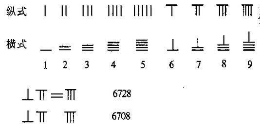
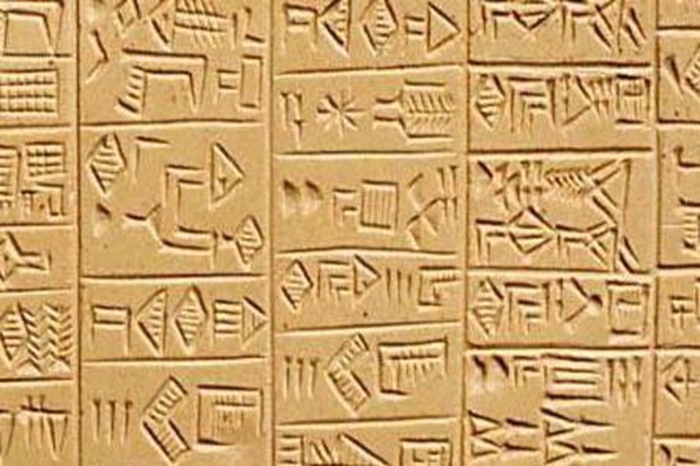
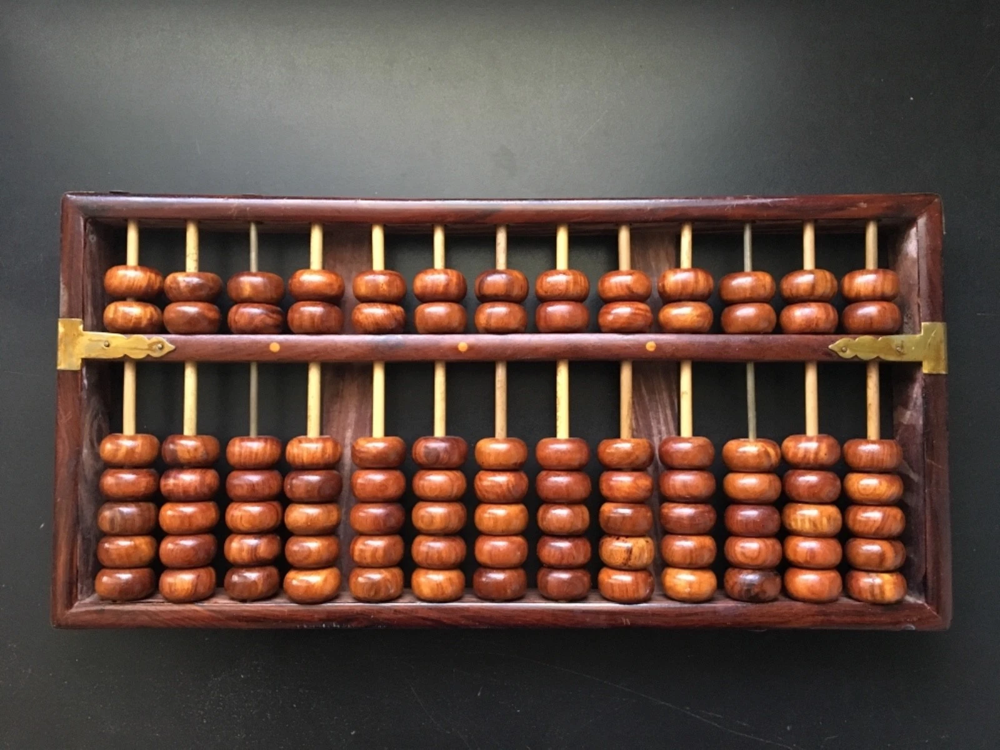
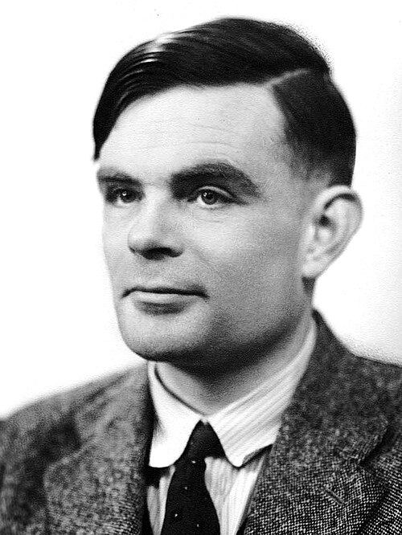
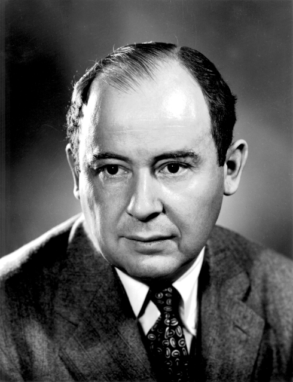
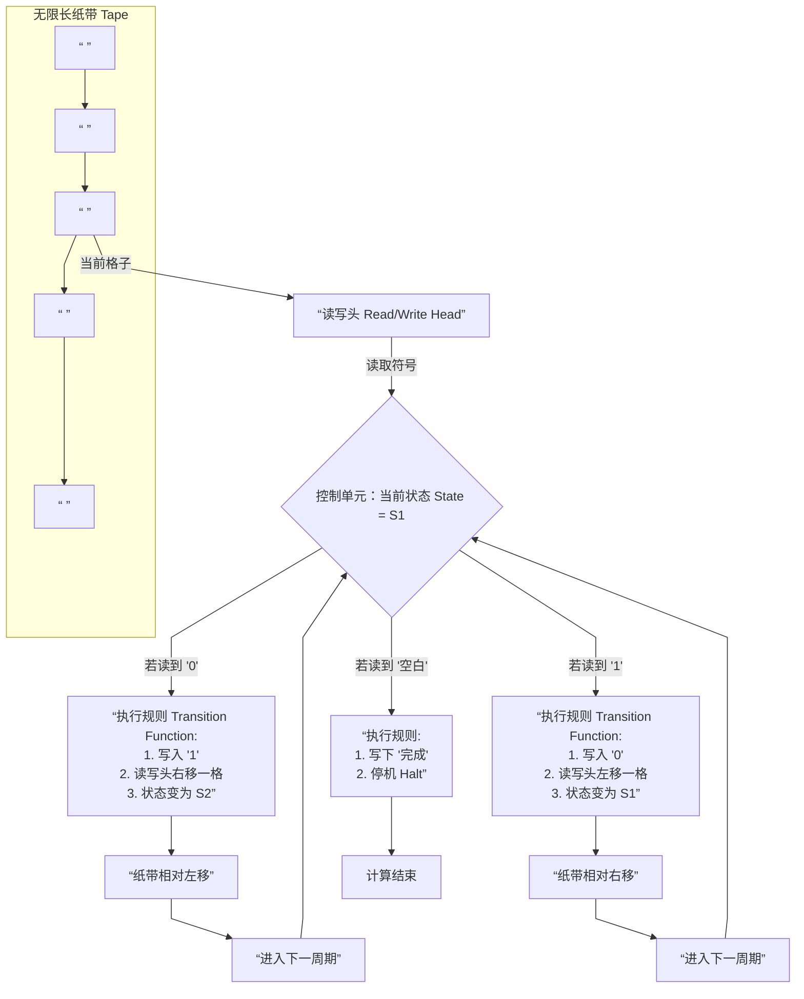
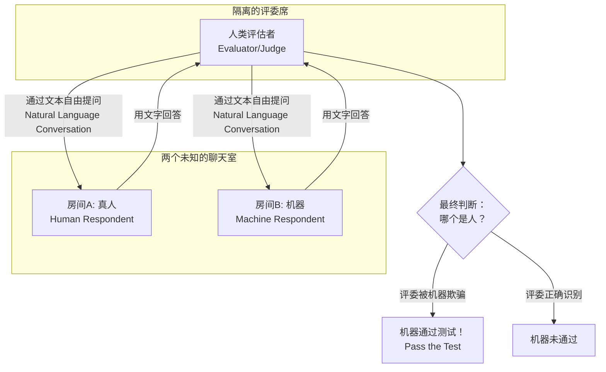
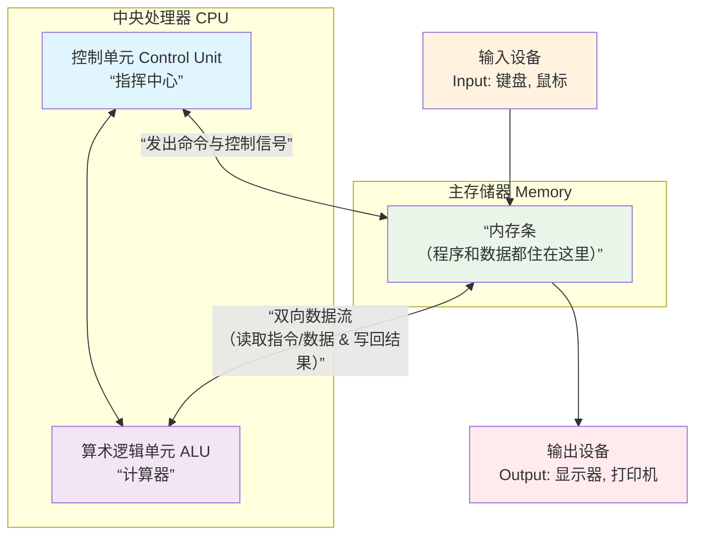
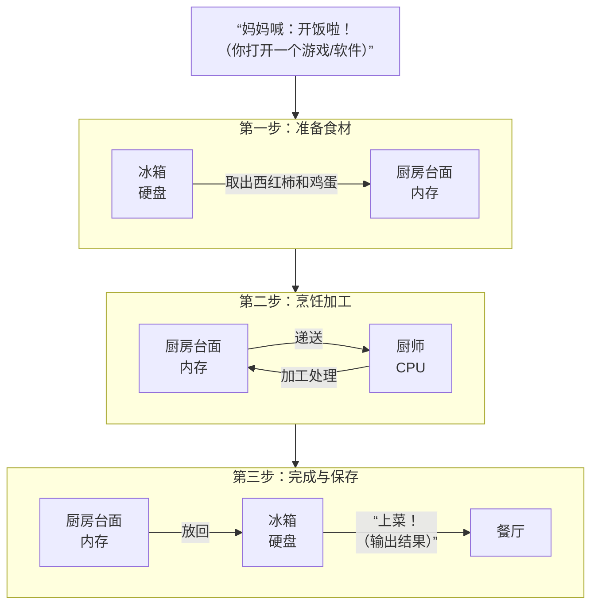

# 
Computer

## 一、人类历史上构建的“计算器”有哪些
# 现代计算器出现前的主要计算工具

以下是现代计算器（即20世纪中叶电子计算器普及之前）出现的主要计算工具，按时间顺序梳理。表格中附有相关图片，部分设备因搜索结果限制未能提供图片，已标注说明。

| 名称 | 出现时间 | 主要用途 | 文明/国家 | 图片 |
|------|----------|----------|-----------|------|
| **算筹** | 古代（不晚于公元5世纪） | 十进制计数与算术运算（加减乘除、开方等） | 中国文明 ||
| **算盘（早期形式）** | 约公元前2700–2300年（美索不达米亚计数板） | 日常商业与数学计算 | 美索不达米亚（苏美尔）文明 |  |
| **中国算盘（珠算）** | 约公元2世纪（汉代）成熟 | 高效进行四则运算、开方等 | 中国文明 | |

### 关于算盘起源的说明
算盘作为一种计算工具，其概念（即使用珠子或计数器在板上滑动）最早可追溯到约公元前2700年的美索不达米亚（苏美尔）文明，当时使用的是“计数板”或“沙盘”。而中国独立发展出的**珠算算盘**（即现代常见的上下珠算盘）在汉代（约公元2世纪）已见雏形，并于唐宋时期成熟，成为中国古代数学和商业计算的核心工具。因此，虽然“算盘”的早期形式出现在多个文明，但中国珠算算盘是其中影响最深远、体系最完善的发明之一，常被列入中国“四大发明”之外的重大技术贡献。

## 二、计算机诞生的背景和关键人物：Turing(图灵)、冯·诺依曼 John von Neumann
# 现代计算机的诞生背景与主要贡献者
Turing(图灵)

John von Neumann（冯.诺伊曼）

1.  **计算需求的演进**：随着科学、工程与商业的发展，对复杂、高速计算的需求日益增长，早期的手工或机械计算工具（如计算尺、机械计算器）已无法满足要求。
2.  **理论基础的成熟**：19世纪至20世纪上半叶，数理逻辑、可计算性理论获得突破，为计算机的构想提供了理论蓝图。
3.  **技术与材料的进步**：继电器的应用，以及随后**晶体管**的发明（1947年），为计算机从机电式转向高速、可靠的电子式提供了物理基础[[2]]。
4.  **第二次世界大战的催化**：战争中对弹道计算、密码破译等任务的紧迫需求，直接催生了如“巨人”计算机（Colossus，用于密码破译）和ENIAC（用于弹道计算）等早期电子计算机项目[[3]]。

| 姓名 | 生卒年 | 国籍 | 主要贡献 | 简要说明 |
| :--- | :--- | :--- | :--- | :--- |
| **查尔斯·巴贝奇** (Charles Babbage) | 1791–1871 | 英国 | 提出并设计了**差分机** (Difference Engine) 与**分析机** (Analytical Engine) | 分析机的设计包含了**输入、处理、存储、输出**等现代计算机的核心概念，被誉为“计算机设计的开山鼻祖”[[4]][[5]]。 |
| **阿达·洛芙莱斯** (Ada Lovelace) | 1815–1852 | 英国 | 为分析机编写了首批**算法**，并预见了计算机超越纯数学计算的潜力 | 通常被认为是**第一位程序员**，她指出了机器通过编程处理任何符号的可能性[[6]]。 |
| **乔治·布尔** (George Boole) | 1815–1864 | 英国 | 创立了**布尔代数** (Boolean Algebra) | 其逻辑代数体系为后世数字电路的设计与计算机的二进制运算奠定了坚实的数学基础[[7]][[8]]。 |
| **阿兰·图灵** (Alan Turing) | 1912–1954 | 英国 | 提出**图灵机** (Turing Machine) 理论模型，奠定**可计算性理论**基础；提出“图灵测试” | 图灵机理论抽象定义了计算的本质，为计算机科学提供了核心理论框架，被誉为“计算机科学之父”[[9]][[10]][[11]]。 |
| **克劳德·香农** (Claude Shannon) | 1916–2001 | 美国 | 创立**信息论**；证明布尔代数可用于数字电路设计 | 其硕士论文《继电器与开关电路的符号分析》将计算机硬件设计建立在严格的数学基础之上[[12]]。 |
| **约翰·阿塔那索夫** (John Atanasoff) & **克利福德·贝里** (Clifford Berry) | 1903–1995 & 1918–1963 | 美国 | 建造了**ABC计算机** (Atanasoff-Berry Computer) | 这是世界上第一台使用**二进制运算**和**电容存储**的电子计算机原型（1939-1942），其设计理念影响深远[[13]][[14]]。 |
| **康拉德·楚泽** (Konrad Zuse) | 1910–1995 | 德国 | 独立建造了**Z系列**机电式可编程计算机 | Z3（1941年）被认为是第一台可工作的、由程序控制的计算机，尽管是机电式的[[15]]。 |
| **约翰·冯·诺依曼** (John von Neumann) | 1903–1957 | 匈牙利裔美国 | 提出“**存储程序**”计算机体系结构（即冯·诺依曼结构） | 该结构明确规定了计算机由五大部件（运算器、控制器、存储器、输入、输出设备）组成，程序与数据共同存储，此架构主导了至今的计算机设计[[16]][[17]][[18]]。 |
| **J. 普雷斯珀·埃克特** (J. Presper Eckert) & **约翰·莫奇利** (John Mauchly) | 1919–1995 & 1907–1980 | 美国 | 领导设计与建造了**ENIAC** (Electronic Numerical Integrator and Computer) | ENIAC（1946年完成）是首台通用、全电子数字计算机，每秒可执行5000次运算，标志着电子计算时代的开启[[19]][[20]]。 |
| **约翰·巴丁、沃尔特·布拉顿、威廉·肖克利** (John Bardeen, Walter Brattain, William Shockley) | 1908–1991, 1902–1987, 1910–1989 | 美国 | 发明了**晶体管** (1947年) | 晶体管的发明取代了笨重、耗能、易损的真空管，使得计算机小型化、可靠化成为可能，是微电子革命的起点，三人因此共获诺贝尔物理学奖[[21]]。 |

## 三、 总结
现代计算机的诞生是**理论构想、工程实践与历史机遇**结合的产物。**巴贝奇**和**布尔**在机械时代便勾勒出蓝图与数学基础；**图灵**和**香农**在理论上完成了关键奠基；**阿塔那索夫、楚泽、埃克特、莫奇利**等人则通过工程实践将其变为现实；而**冯·诺依曼**提出的体系结构为这些工程成果提供了清晰、高效的组织范式。这些贡献者的工作层层递进，共同塑造了我们今天所知的计算机。

## 三、现代计算机和AI智能的关键理论：

## 一、 图灵机：所有计算机的“设计蓝图”

图灵机不是一个真实的机器，而是艾伦·图灵在1936年提出的一种**思想模型**。它用一套极简的规则，定义了什么是“计算”。

### 核心工作原理图（更新版）
下图直观展示了图灵机如何工作：一条**纸带**，一个**读写头**，以及一套控制它的**规则**。

### 关键部件与术语解析
让我们结合新图表，再次认识图灵机的各个“器官”：

| 部件/术语 (英文) | 在图表和比喻中的角色 |
| :--- | :--- |
| **纸带 (Tape)** | 图表顶部的 **“无限长纸带”**。它是机器的“记忆本”，由一系列格子组成，可以写入或擦除符号（如0,1,空白）。 |
| **读写头 (Read/Write Head)** | 指向纸带当前格子的 **“读写头”**。它是机器的“眼睛和手”，一次只“看”一个格子，并可根据规则修改它。 |
| **状态 (State)** | 控制单元中的 **“当前状态”**。就像机器人的“工作模式”（例如：“模式S1”）。**初始状态 (Initial State)** 是计算开始的第一个状态。 |
| **转移函数 (Transition Function)** | 图中所有的 **“执行规则”** 方框。这是机器内置的“行动指南手册”，严格规定了在**某个状态**下看到**某个符号**时，应该：**1. 写入什么符号；2. 向哪移动读写头；3. 切换到什么新状态**。 |
| **停机 (Halt)** | 最终的 **“计算结束”** 状态。与之相关的 **停机问题 (Halting Problem)** 是一个深刻的发现：**我们无法提前预知任意一个程序（图灵机）在给定输入下是否会最终停止**。 |
| **通用图灵机 (Universal Turing Machine)** | **一个可以扮演任何其他图灵机的“超级图灵机”**。它的“规则表”可以读取并执行其他图灵机的描述。这就是现代**可编程计算机**的核心思想：硬件不变，通过加载不同软件（程序）来完成不同任务。 |

**给小朋友的总结**：
> 图灵机告诉我们，任何复杂的计算，都可以拆解成一系列“**在某个状态下，看到符号，然后写符号、移动、改状态**”的简单步骤。我们今天的电脑、手机，都是速度超快的物理版“图灵机”！

---

## 二、 图灵测试：判断机器是否聪明的“模仿游戏”

图灵在1950年提出了一个巧妙的测试，来回避“机器能思考吗？”这个哲学难题。他的问题是：**如果一台机器表现得和人一样聪明，那我们是否应该承认它是智能的？**

### 测试流程示意图
下图展示了这个“猜猜谁是AI”的游戏是如何进行的：

### 游戏角色与核心术语
结合上图，我们来认识游戏中的玩家和规则：

| 角色/术语 (英文) | 在图表和游戏中的角色 |
| :--- | :--- |
| **评估者/法官 (Evaluator/Judge)** | **隔离的评委**。他/她的任务是通过纯文字聊天，判断两个聊天对象中哪一个是人。 |
| **人类受访者 (Human Respondent)** | **房间A的真人**。他/她只需要正常、诚实地回答问题。 |
| **机器受访者 (Machine Respondent)** | **房间B的AI程序**。它的核心目标是**模仿人类 (Imitation Game)**，努力让评估者相信它是真人。 |
| **自然语言对话 (Natural Language Conversation)** | 连接各方的**文本对话箭头**。测试必须使用日常的、不受限的语言进行，这是考验机器理解与沟通能力的关键。 |
| **通过测试 (Pass the Test)** | 游戏的胜利条件。如果在一系列测试中，机器被误认为是人的概率，和真人被误认的概率一样高，那么我们就说这台机器**通过了图灵测试**。 |

**给小朋友的总结**：
> 图灵测试就像一场“盲聊”游戏。如果一个AI在文字聊天中让你完全感觉不到它是机器，那么它就通过了测试。这提醒我们，**智能可以通过外在行为来观察和判断**。今天很多聊天机器人，都在为通过这个测试而努力。

---

### 课堂终极联系

*   **图灵机 (1936)** 回答了 **“计算是什么？”**，它设计了计算机的**身体和基本工作法则**。
*   **图灵测试 (1950)** 回答了 **“如何判断机器有智能？”**，它设定了人工智能的**一个行为目标**。

**奇妙的关系**：今天，我们用来挑战“图灵测试”的AI程序，正是运行在按照“**通用图灵机**”原理建造的计算机上的。**一个定义了机器的“能力”边界，另一个则挑战机器的“智能”高度。**

好的，老师！接下来，我们介绍让理论变成现实的伟大设计——**冯·诺伊曼结构**。它被称为现代计算机的“大脑蓝图”，至今几乎所有计算机都在使用这个设计。

---

## 第一台计算机和主要问题：
虽然冯·诺伊曼在1945年的报告中系统阐述了这一思想，但第一台成功运行并证明该概念的计算机是1948年在英国曼彻斯特大学诞生的 **“曼彻斯特婴儿”**（Manchester Baby，或称SSEM）。

与庞大的ENIAC相比，“婴儿”机非常简陋，但它做了一个划时代的演示：**将一个寻找最大因数的程序（17条指令）成功加载到其威廉姆斯阴极射线管存储器中并运行**。这证明了“存储程序”的设想是完全可行的，从此开启了现代计算机的软件时代。

### 总结
简单来说，**“存储程序”概念的提出，是为了让计算机从一台需要人工“布线”的、笨重的专用计算器，转变为一台可以通过“换程序”来执行任何任务的、高速且自动的通用机器。**

它就像给计算机赋予了“灵魂”：硬件是身体，而存储在内存中的程序是思想和知识。身体不变，但换一套思想，就能从事完全不同的工作。我们今天所有的电脑、手机和智能设备，都根植于这个70多年前的伟大构想。

## 三、 冯·诺伊曼结构：现代计算机的“身体构造图”

在图灵机告诉我们“**计算是什么**”之后，科学家冯·诺伊曼和他的同事们提出了一个切实可行的建造方案，回答了“**计算机应该怎么造**”的问题。这个方案的核心革命性思想就是 **“存储程序”**。

### 核心思想：存储程序革命
在早期的计算机里，**程序（指令序列）** 和 **数据** 是分开存放的。改变程序就像给一台巨大的电话交换机重新插线，非常麻烦。

冯·诺伊曼的伟大想法是：
> **把程序像数据一样，也存放在计算机的内存里。**
> 这样，计算机就可以通过快速读取内存中的指令，自动、连续地执行任务，而无需人为改变硬件连接。

### 体系结构示意图：五大部件如何协同工作
下图展示了一台基于冯·诺依曼结构的计算机是如何工作的，它就像一个高效协作的团队：

**工作流程（结合图表看）**：
1.  **输入**：我们通过键盘、鼠标（**输入设备**）将**程序和数据**送入**内存**。
2.  **取指令**：**控制单元（CU）** 从内存中取出程序的第一条指令。
3.  **解码与指挥**：**控制单元（CU）** 理解这条指令是什么意思，然后指挥全城。
4.  **执行**：
    *   如果需要计算，**控制单元（CU）** 就命令**算术逻辑单元（ALU）** 从内存里取数据，然后进行加、减、比较等操作。
    *   如果需要存结果，**控制单元（CU）** 就命令将结果写回**内存**。
5.  **重复与输出**：**控制单元（CU）** 取下一条指令，重复步骤2-4，直到程序结束。最后，将结果从**内存**送到显示器或打印机（**输出设备**）上。

### 关键术语与部件解析
让我们像认识身体器官一样，认识计算机的五大部件：

| 部件/术语 (英文) | 在图表和比喻中的角色 | 它像什么？ |
| :--- | :--- | :--- |
| **中央处理器 (CPU)** | 图表顶部的 **“中央处理器”** 大盒子。它是计算机的**大脑**，负责执行所有指令。 | **整个团队的“总指挥和数学家”**。 |
| **控制单元 (CU)** | CPU 里的 **“指挥中心”**。它不计算，只做三件事：**取指令、解码指令、指挥其他部件干活**。 | **乐队的指挥**。他不演奏乐器，但决定节奏和谁该出场。 |
| **算术逻辑单元 (ALU)** | CPU 里的 **“计算器”**。专门负责所有数学运算（加减乘除）和逻辑判断（比较大小、判断对错）。 | **团队里的专职数学家**，只负责算数。 |
| **主存储器 (内存, Memory)** | 中间的 **“内存条”**。它是计算机的**工作台**，**程序和数据在运行时都存放在这里**。特点是**速度快**，但**断电后内容会消失**。 | **厨房里的操作台**。厨师（CPU）把菜谱（程序）和食材（数据）放在手边，方便快速取用。 |
| **输入设备 (Input)** | 左侧的 **“键盘、鼠标”**。负责把外部信息（你的命令、文章、图片）转换成计算机能懂的数字信号，送进内存。 | **你的眼睛和耳朵**，负责接收外界信息。 |
| **输出设备 (Output)** | 右侧的 **“显示器、打印机”**。负责把计算机处理完的数字结果，转换成你能看懂的文字、图片或声音。 | **你的嘴巴和手**，负责把想法表达出来。 |
| **总线 (Bus)** | 图表中连接所有部件的**箭头和数据流**。它是一条**电子高速公路**，负责在部件之间搬运指令和数据。 | **学校里的走廊和传送带**，把学生（数据）和通知（指令）送到不同的教室（部件）。 |
| **存储程序概念 (Stored-Program Concept)** | **整个图的核心思想**。它意味着**程序（菜谱）和数据（食材）被平等地存放在内存（操作台）上**。CPU可以像读取数据一样快速读取下一条指令，从而实现自动、高速的连续计算。 | **革命性的改变**：以前改变程序要重新“布线”（像重新装修厨房），现在只需要换一张“菜谱”（加载新程序到内存）。 |

**给小朋友的总结**：
> 冯·诺伊曼结构给计算机设计了一张完美的“身体构造图”：**一个通过“总线”连接了“大脑（CPU）”、“工作台（内存）”、“感官（输入）”和“手脚（输出）”的身体**。而“**存储程序**”思想是它的灵魂，让计算机变得**通用**和**自动**——同一台机器，换不同的程序就能做不同的事，这正是通用图灵机的物理实现！

---

### 知识连线：从图灵到冯·诺伊曼

| 概念 | 贡献 | 关系 |
| :--- | :--- | :--- |
| **图灵机 (1936)** | **理论模型**。定义了计算的本质和极限，提出了“**通用计算机**”的设想。 | 提出了 **“做什么 (What)”** 的蓝图。 |
| **冯·诺伊曼结构 (1945)** | **工程架构**。给出了建造通用计算机的具体方法，核心是 **“存储程序”**。 | 解决了 **“怎么做 (How)”** 来建造它。 |

**简单说**：图灵在纸上画出了“汽车”应该能跑的原理图；而冯·诺伊曼则画出了第一辆现代汽车的设计图——**有发动机(CPU)、油箱和地图(内存)、方向盘和油门(输入)、车灯和仪表盘(输出)**，并且让“驾驶指令”（程序）可以随时更换。我们今天用的每一台电脑、手机和平板，都是这个设计的超级进化版。

你想知道为什么会有“存储程序”这个革命性的想法，以及它到底解决了什么问题。让我们回到计算机的“史前时代”，从第一台电子计算机说起，故事就清楚了。

### 第一台电子计算机：ENIAC
世界上第一台通用电子计算机是 **ENIAC**（埃尼阿克，1946年正式投入使用）。它是个不折不扣的“庞然大物”：重达30吨，占地170平方米，使用了约18000个电子管。

ENIAC非常强大，能够执行复杂的弹道计算。但是，它有一个在今天看来非常不可思议的缺点：**给它换一个计算任务，极其麻烦**。

### “存储程序”概念要解决的核心问题
在ENIAC上，**程序（指令序列）并不是存储在内存中的**。它的工作方式是：
1.  **物理编程**：程序员需要通过手动设置**数千个开关**，并插拔**无数根电缆**来“告诉”计算机每一步该做什么。
2.  **专用机器**：一旦为某个任务（比如计算炮弹轨迹）设置好，它就只能做这一件事。如果想让它计算天气，就需要一群工程师花上**几天甚至几周**的时间重新布线、设置开关。

这就像你想换一首歌听，不是按一下播放键，而是需要亲自走进唱片机，重新刻录一张唱片一样。

**“存储程序”概念，正是为了彻底解决这些问题而诞生的。** 它的核心思想是：**将程序指令和数据一样，以数字形式存储在同一个内存里**。这样，计算机在工作时，就可以像读取数据一样，快速地从内存中读取下一条指令。

### 它具体解决了三大难题：

| 问题 | 存储程序如何解决 | 比喻 |
| :--- | :--- | :--- |
| **1. 重新配置的繁琐与缓慢** | 程序存储在内存中，改变任务只需**更换内存中的程序**（例如从打孔卡片或磁带读入新程序），过程从“几天”缩短到“几分钟”。 | **ENIAC**：像老式电话总机，接线员（程序员）必须手动插拔线缆才能接通不同电话（任务）。 **存储程序计算机**：像自动交换机，只需输入号码（程序），内部自动完成所有连接。 |
| **2. 执行速度的瓶颈** | 指令直接从高速内存中读取，无需等待慢速的外部输入设备（如读卡器）一条条送入。CPU可以全速运行。 | 厨师（CPU）做菜时，不用每次都跑到书架（外部设备）去翻看菜谱（指令），而是把整本菜谱（程序）摊开放在手边的案板（内存）上，随时快速查阅。 |
| **3. 通用性与自动化的实现** | 这是最根本的突破。计算机的硬件变得“通用”，其功能完全由存储在内存中的“软件”（程序）决定。计算机可以自动、连续地执行程序，无需人工干预。 | 同一台游戏机，换不同的卡带（程序）就能玩不同的游戏。计算机从此成为一台**通用机器**。 |

## 常见的“存储”：
好的，以下是硬盘与内存条核心区别的详细对比，以 Markdown 格式呈现。

# 硬盘与内存条核心区别详解

## 一、核心定义与角色比喻

| 特性 | **硬盘 (硬盘驱动器/固态硬盘)** | **内存条 (随机存取存储器)** |
| :--- | :--- | :--- |
| **核心角色** | **数据的长期仓库** | **数据的临时工作台** |
| **主要功能** | 永久存储操作系统、软件、文档、媒体文件等所有数据。 | 临时存放当前正在运行的程序和正在被处理的数据，供CPU高速读取。 |
| **类比** | **书房的书架**：存储你所有的书籍（数据），容量大，存取速度相对慢。 | **书桌上的空间**：只放你当前正在阅读和书写的几本书（活跃数据），空间有限，但拿取和放回极快。 |

## 二、核心特性对比表

| 对比维度 | **硬盘** | **内存条** |
| :--- | :--- | :--- |
| **存储性质** | **非易失性存储** | **易失性存储** |
| 断电后数据 | **永久保留**。关机后所有文件仍存在。 | **完全丢失**。关机或重启后，内存中的数据会被清空。 |
| **存取速度** | **相对慢**（特别是机械硬盘）。 | **极快**。速度通常是硬盘的数十倍乃至数百倍。 |
| 速度影响 | 影响开机、打开软件、加载文件的速度。 | 直接影响软件运行的流畅度、多任务切换速度。 |
| **物理形态与位置** | **硬盘（HDD/SSD）**、M.2 SSD。通常固定在机箱内。 | **内存条（DIMM模块）**。插在主板的内存插槽上。 |
| **容量** | **大**。通常为**256GB - 数TB**。 | **小**。通常为**8GB - 128GB**。 |
| **成本** | 单位容量成本**低**。 | 单位容量成本**高**。 |
| **与CPU的关系** | CPU不直接处理硬盘数据，需先调入内存。 | CPU**直接**与内存交换数据，是CPU的“直接工作区”。 |

CPU/内存/硬盘的协同关系：

---

### 角色介绍卡

**1. 厨师长 - CPU**
*   **工作**：负责**思考**和**计算**。比如做一道“西红柿炒鸡蛋”，CPU就是决定“先炒鸡蛋还是先炒西红柿”、“放多少盐”的那个大脑。它处理一切复杂的指令。
*   **特点**：速度超快，但自己**不记菜谱**，也不**存放食材**。

**2. 厨房台面 - 内存**
*   **工作**：**临时摆放**从冰箱拿出来的食材（西红柿、鸡蛋），以及厨师正在处理的半成品（打好的蛋液、切好的西红柿）。厨师（CPU）只从台面上拿东西加工。
*   **特点**：
    *   **速度很快**，厨师一伸手就能拿到。
    *   **空间有限**：台面太小（内存小）就放不下太多食材，厨师干活就束手束脚，会卡顿。
    *   **临时性**：做完饭，台面就会被清空。**一断电**，台面上的所有东西（正在运行的程序和数据）就全部消失。

**3. 大冰箱和储物柜 - 硬盘**
*   **工作**：**长期储存**所有食材（游戏、软件、照片、文档）。当你不需要时，东西都安静地放在里面。
*   **特点**：
    *   **容量巨大**：能存海量东西。
    *   **速度较慢**：每次取放食材（打开文件/加载游戏）都需要开门、寻找、拿取，比从台面上直接拿慢得多。
    *   **永久保存**：**断电后**，里面的东西也安然无恙。

---

### 它们是如何协同工作的？（以你打开一个游戏为例）

**第一步：准备阶段**
你说：“我要玩《XX游戏》！”（你双击了游戏图标）。
1.  **厨师（CPU）** 接到指令，命令去**冰箱（硬盘）** 里找到《XX游戏》这道大菜的“全部食材和菜谱”（游戏程序文件）。
2.  这些食材被**拿出来，铺在厨房台面（内存）** 上。这样，厨师才能快速开始加工。

**第二步：烹饪阶段**
游戏开始运行！
1.  你控制的角色在跑、跳、打怪……这些实时操作都由**厨师（CPU）** 飞速计算。
2.  计算所需的所有数据（比如地图、怪物位置、你的血量）都放在**台面（内存）** 上，方便CPU随时取用。
3.  游戏中的精美画面、声音，也是CPU根据内存里的数据加工好后，送给显示器（餐厅上菜）的。

**第三步：保存与结束**
你想存盘退出。
1.  厨师（CPU）将**台面（内存）** 上最新的游戏进度（比如你到达了第5关）整理好。
2.  然后，把这些成果**放回冰箱（硬盘）** 里永久保存起来。
3.  最后，你关闭游戏，**清空了台面（内存）**，厨房为下一道“菜”做好准备。

---

### 简单总结

*   **CPU（厨师）**：**“干啥？”** 负责所有计算和思考。
*   **内存（台面）**：**“正在干啥？”** 临时放CPU正在处理和马上要用到的东西。**决定了你能同时流畅地干多少活**。
*   **硬盘（冰箱）**：**“有啥？”** 永久存放所有东西。**决定了你能存多少东西**。

**这样想就懂了：一个厨房，冰箱再大（硬盘大），如果台面太小（内存小），厨师一次只能处理一点点食材，做大餐就会手忙脚乱；反过来，台面很大但厨师很慢（CPU慢），做饭的效率也高不起来。它们三个必须默契配合，你的电脑才能飞快！**

## 电脑上我们要求计算机执行1+1加法时，CPU实际执行的程序：

global _start          ; 告诉链接器入口点是 _start

_start:
    mov rax, 1             ; 将第一个数字 1 放入寄存器 rax
    mov rbx, 1             ; 将第二个数字 1 放入寄存器 rbx
    add rax, rbx           ; 执行加法：rax = rax + rbx，现在 rax 的值是 2
    mov rax, 60            ; 60 是 exit 的系统调用号
    syscall                ; 执行系统调用，程序结束，退出码为 2

以下是常见 CPU 指令类别的汇总表格，涵盖了最核心和常用的操作。

| 类别 | 常见指令助记符 | 主要功能描述 |
| :--- | :--- | :--- |
| **数据传送** | `MOV` | 在寄存器、内存和立即数之间复制数据。这是最频繁使用的指令。 |
| | `LEA` | 计算内存地址并加载到寄存器，而非该地址处的数据。常用于地址运算。 |
| **算术运算** | `ADD`, `SUB` | 执行加法和减法运算。 |
| | `INC`, `DEC` | 将操作数加1或减1。 |
| | `MUL`, `DIV` | 执行乘法和除法运算（通常有特定寄存器约定）。 |
| | `CMP` | 比较两个操作数（实质是做减法），并设置标志位，但不保存结果。 |
| **逻辑与位运算** | `AND`, `OR`, `NOT`, `XOR` | 执行按位的逻辑与、或、非、异或操作。常用于掩码、清零和标志位操作。 |
| | `SHL`/`SAL`, `SHR`, `SAR` | 将操作数的二进制位向左或向右移动。用于快速乘除2或位操作。 |
| **流程控制** | `JMP` | 无条件跳转到指定地址执行。 |
| | `JE`/`JZ`, `JNE`/`JNZ` | 根据标志位进行条件跳转（等于/零，或不等于/非零）。 |
| | `JG`/`JNLE`, `JL`/`JNGE` | 根据标志位进行条件跳转（大于或小于）。 |
| | `CALL`, `RET` | 调用子程序（函数）和从子程序返回。 |
| **栈操作** | `PUSH`, `POP` | 将操作数压入栈顶，或从栈顶弹出数据。用于保存/恢复寄存器、传递参数等。 |
| **系统控制** | `INT`, `SYSCALL`/`SYSENTER` | 触发软件中断或系统调用，将控制权转移给操作系统内核。 |
| | `IRET`, `SYSRET` | 从中断或系统调用返回。 |

**简要说明：**
*   不同架构（如 x86、ARM、MIPS）的指令助记符和具体语法可能不同，但上述功能类别是通用的。
*   流程控制指令（尤其是条件跳转）与 `CMP` 指令的配合，是实现程序分支、循环等逻辑的基石。
*   栈操作是函数调用、局部变量管理和中断处理的基础机制。
*   

你好！计算机就像一台超级智能的机器，它的基本组成可以用一个非常经典的模型来解释，这个模型叫做 **“冯·诺依曼结构”**。它把计算机分成了五个主要部分，它们相互配合，共同工作。

下面这张图就是这个经典结构的直观展示：

你可以把计算机想象成一个**超级厨房**，我们来对照这张图看看每个部分的作用：

| 组成部分 | 在“厨房”里的角色 | 主要功能与常见设备 |
| :--- | :--- | :--- |
| **1. 输入设备** | **采购员和传菜员** | 负责把外部的信息、指令“送进”计算机。就像你把食材和菜谱交给厨房。 **例如：** 键盘、鼠标、麦克风、摄像头、扫描仪。 |
| **2. 存储器** | **仓库和工作台** | 负责保存所有数据和程序。 - **内存 (RAM)**：像**工作台**，厨师（CPU）直接在这里处理食材。速度快，但关机后内容就清空了。 - **外存 (硬盘/SSD)**：像**大冰箱和仓库**，长期保存所有食材（文件）和菜谱（软件）。速度慢，但能永久保存。 |
| **3. 运算器** | **厨师的手** | 是CPU（中央处理器）的一部分，专门负责进行所有的**数学计算**和**逻辑判断**，比如加减乘除、比较大小。 |
| **4. 控制器** | **厨师的脑** | 是CPU的指挥中心。它从内存中读取指令（菜谱步骤），然后指挥运算器、存储器等所有部分协调工作。**运算器 + 控制器 = 完整的CPU**。 |
| **5. 输出设备** | **传菜窗口和广播** | 负责把计算机处理好的结果“送出来”给你看、听或使用。就像把做好的菜端上餐桌。 **例如：** 显示器、打印机、音箱、耳机。 |

**它们是如何一起工作的？（看看图中的箭头方向）**
1.  **输入**：你用鼠标点击或键盘打字（输入设备）。
2.  **存储与读取**：你的指令被送到“内存”中暂存。
3.  **处理**：**控制器**从内存里拿到指令，指挥**运算器**开始疯狂计算。
4.  **再存储**：处理中的中间结果和最终结果，会再存回“内存”。
5.  **输出**：最后，处理好的结果（比如一个游戏画面、一段音乐）从内存被送到显示器或音箱（输出设备）展示给你。

简单来说，**数据就像食材，从输入设备流入，在存储器里待命，被CPU（运算器+控制器）加工，最后通过输出设备呈现出来**。这个循环不息的过程，就是计算机工作的基本原理。

希望这个比喻和这张经典的图能帮你一下子看懂计算机的组成！

图灵机是计算机的理论基石，你可以把它想象成一个拥有“超级规则”的**自动写字机器人**。它由五个核心部分组成，下面我用实物比喻和图片来为你一一呈现[[1]]。

### 图灵机的五大组件实物呈现

| 组件 | 实物比喻与功能 | 图示（核心部件示意） |
| :--- | :--- | :--- |
| **1. 无限长的纸带** | **一卷无限长的格子笔记本** 这是图灵机的“记忆”，可以向左向右无限延伸。每个格子可以写一个符号（比如0、1或空格），就像笔记本的每一格。 | [[2]] |
| **2. 读写头** | **一支可移动的铅笔+橡皮+扫描笔** 它停在纸带的某一格上，可以**读取**格子里的符号，也可以**擦掉**旧符号**写入**新符号。写完还能根据指令向左或向右移动一格。 | （同上图，读写头是控制器下方指向纸带的箭头部分）[[3]] |
| **3. 状态寄存器** | **一张记录当前“心情”的便签** 它记录图灵机当前所处的“状态”（比如“正在寻找数字”、“正在计算中”、“已完成”）。状态数量有限，其中有一个特殊的**停机状态**，表示任务完成。 | [[4]] |
| **4. 控制规则（程序）** | **一本详细的“菜谱”或指令表** 这是图灵机的“大脑”或算法。它严格规定：**如果**机器现在是状态A**并且**读写头读到符号X，**那么**就执行三步操作：1. 把符号X改成Y；2. 将读写头向左/右移动一格；3. 把状态变成B。 | （控制规则通常以表格或列表形式存在，是机器内部的逻辑）[[5]] |
| **5. 符号表** | **一份允许使用的“字母表”** 它定义了纸带上允许出现的所有符号集合，比如 {0, 1, #, $, _}，其中必定包含一个特殊的**空白符号**（通常用 `_` 或 `B` 表示），代表格子是空的[[6]]。 | （符号表是抽象定义，通常不单独图示，但纸带上的0、1和空格就是它的体现） |

### 它们如何协同工作？
想象一下这个自动机器人如何工作：
1.  **启动**：纸带上预先写好一串符号（输入），读写头指向某个位置，状态寄存器设为“开始”。
2.  **查看并决策**：读写头读取当前格子的符号，状态寄存器查看当前状态。两者一起交给“控制规则”查表。
3.  **执行动作**：根据规则表，机器人执行三个动作：**写入**一个新符号到当前格子、**移动**读写头到左或右的相邻格子、**更新**状态寄存器为一个新状态。
4.  **循环或停止**：重复步骤2和3。一旦状态寄存器变为“停机状态”，机器人就停止工作。此时纸带上留下的符号序列就是最终的**输出**结果。

简单来说，**纸带是无限记忆，读写头是眼睛和手，状态寄存器是当前进度，控制规则是智能说明书，符号表是可用字符集**。这五个部分一起，构成了这个能模拟任何计算过程的强大理论模型[[7]]。